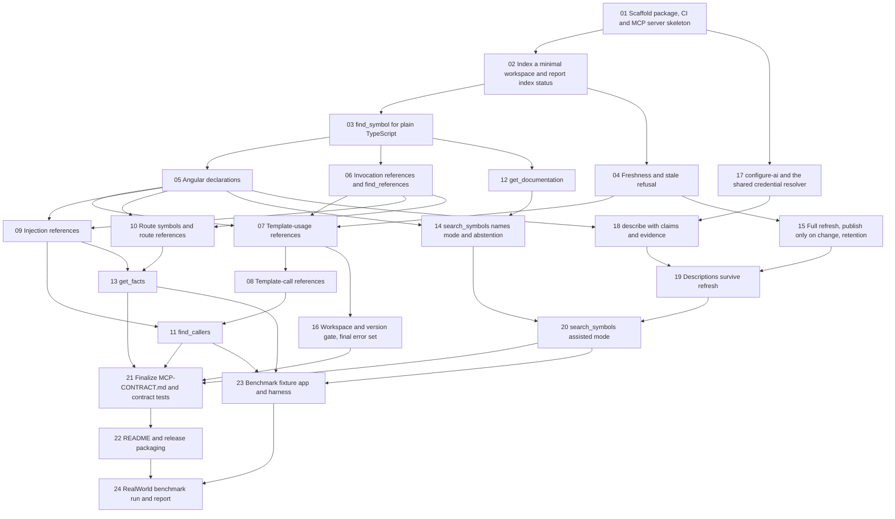

# CodeAtlas Angular task board

Source: [PRD 0001](../prd/0001-initial.md). Each task is a vertical slice for one coding session. Each task adds its own `MCP-CONTRACT.md` section; task 21 consolidates it.

Can start now (no blockers): 01. After 01 is done, 02 and 17 can start.

| # | Task | Blocked by | Status |
|---|---|---|---|
| 01 | [Scaffold package, CI and MCP server skeleton](01-scaffold-package-ci-mcp-skeleton.md) | None | done |
| 02 | [Index a minimal workspace and report index status](02-index-minimal-workspace-index-status.md) | 01 | done-awaiting-merge |
| 03 | [find_symbol for plain TypeScript](03-find-symbol-typescript.md) | 02 | ready |
| 04 | [Freshness and stale refusal](04-freshness-stale-refusal.md) | 02 | in-test |
| 05 | [Angular declarations](05-angular-declarations.md) | 03 | ready |
| 06 | [Invocation references and find_references](06-invocation-references-find-references.md) | 03 | ready |
| 07 | [Template-usage references](07-template-usage-references.md) | 04, 05, 06 | ready |
| 08 | [Template-call references](08-template-call-references.md) | 07 | ready |
| 09 | [Injection references](09-injection-references.md) | 05, 06 | ready |
| 10 | [Route symbols and route references](10-routes.md) | 05, 06 | ready |
| 11 | [find_callers](11-find-callers.md) | 08, 09 | ready |
| 12 | [get_documentation](12-get-documentation.md) | 03 | ready |
| 13 | [get_facts](13-get-facts.md) | 09, 10 | ready |
| 14 | [search_symbols names mode and abstention](14-search-symbols-names-abstention.md) | 05, 12 | ready |
| 15 | [Full refresh, publish only on change, retention](15-refresh-retention.md) | 04 | ready |
| 16 | [Workspace and version gate, final error set](16-workspace-version-gate-errors.md) | 07 | ready |
| 17 | [configure-ai and the shared credential resolver](17-configure-ai-credentials.md) | 01 | ready |
| 18 | [describe with claims and evidence](18-describe-claims-evidence.md) | 05, 17 | ready |
| 19 | [Descriptions survive refresh](19-descriptions-survive-refresh.md) | 15, 18 | ready |
| 20 | [search_symbols assisted mode](20-search-symbols-assisted.md) | 14, 19 | ready |
| 21 | [Finalize MCP-CONTRACT.md and contract tests](21-mcp-contract-final.md) | 11, 13, 16, 20 | ready |
| 22 | [README and release packaging](22-readme-release-packaging.md) | 21 | ready |
| 23 | [Benchmark fixture app and harness](23-benchmark-fixture-harness.md) | 11, 13, 20 | ready |
| 24 | [RealWorld benchmark run and report](24-realworld-benchmark-run.md) | 22, 23 | ready |

## Dependency graph

